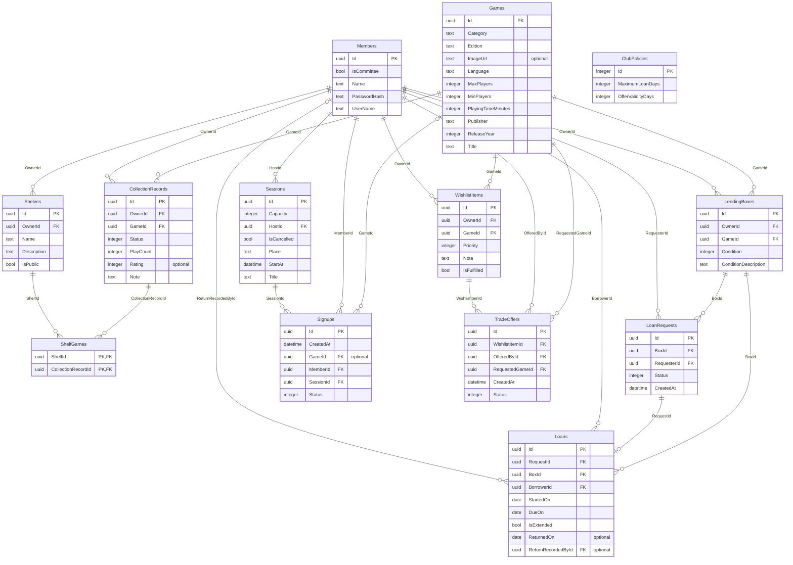

# GameShelf database

De SQLite-database bevat het schema voor de volledige opdracht. Login en sessies gebruiken deze database al. De bestaande collectie-, shelf-, uitleen-, wishlist- en profielpagina's tonen nog hun eigen voorbeelddata: het toevoegen van hun tabellen maakt die pagina's niet automatisch dynamisch.

## Bestanden

- `gameshelf-demo.db`: een zelfstandige demodatabase met voorbeeldgegevens; geschikt om te openen in DB Browser for SQLite.
- `../back-end/GameShelf.Api/gameshelf.db`: de lokale werkdatabase van de API. De bestaande sessies en aanmeldingen zijn bij de upgrade behouden.
- `gameshelf-erd.md`: het volledige ERD als gerenderd Mermaid-diagram.
- `gameshelf-erd.png`: een PNG-export van het Mermaid-diagram.
- `gameshelf-erd.svg`: een aanvullende afbeelding van het ERD.
- `gameshelf-erd.mmd`: hetzelfde ERD als bewerkbare Mermaid-bron.
- `gameshelf-erd.dot`: Graphviz-bron van de afbeelding.
- `gameshelf-schema.sql`: schema en migratiemetadata zonder demo-inhoud.
- `verify_database.py`: controleert hashes, relaties, unieke records en cascadeverwijdering zonder de demodatabase te wijzigen.
- `export_schema.py`: genereert de SQL-, Mermaid- en DOT-bestanden uit de echte demodatabase.

<!-- ERD:START -->

<!-- ERD:END -->

In het ERD betekent `PK` primaire sleutel, `FK` vreemde sleutel en `optional` dat een veld leeg mag zijn (in de SVG aangeduid met `?`). `1` betekent precies één, `0..1` nul of één, en `0..*` nul of meer. GUID's worden in SQLite als `TEXT` opgeslagen, booleans als `INTEGER` en datums als ISO-tekst.

## Tabellen en relaties

| Tabel | Wat wordt bijgehouden? |
| --- | --- |
| Members | Naam, unieke gebruikersnaam, commissierol en gehasht wachtwoord. |
| Games | Eén editie: titel, uitgever, jaar, categorie, taal, editienaam, spelersbereik, speeltijd en optionele afbeelding. Nederlands en Engels zijn aparte records. |
| CollectionRecords | Eén record per eigenaar en spel: status, aantal gespeelde potjes, optionele rating van 1–10 en notitie. |
| Shelves | Eigenaar, naam, beschrijving en publiek/privé. |
| ShelfGames | Koppelt een shelf aan een collectierecord; hetzelfde spel kan op meerdere shelves staan. |
| LendingBoxes | Fysieke box met eigenaar, catalogusspel, staat en beschrijving; geen verplichte relatie met een collectie. |
| LoanRequests | Box, aanvrager, status en aanvraagmoment. |
| Loans | Goedgekeurd verzoek, box, lener, startdag, retourafspraak, verlengingsvlag, retourdag en degene die de retour registreert. |
| Sessions | Host, titel, datum/tijd, plaats, capaciteit en annuleringsvlag. |
| Signups | Sessie, lid, status, aanmeldmoment en optioneel meegenomen spel. |
| WishlistItems | Eigenaar, gewenst catalogusspel, prioriteit, notitie en vervuld-vlag. |
| TradeOffers | Wishlist-item, aanbieder, gevraagd spel in ruil, aanmaakmoment en status. Het aangeboden spel volgt uit het wishlist-item. |
| ClubPolicies | Eén instellingenrecord met maximale uitleenduur en geldigheidsduur van aanbiedingen. |

`__EFMigrationsHistory`, `__EFMigrationsLock` en `__GameShelfSeedHistory` zijn technische tabellen en staan niet in het ERD. Zij registreren schema-updates, de migratielock en de eenmalige wijziging van de demowachtwoorden.

## Wat de database afdwingt

- Vreemde sleutels voorkomen verwijzingen naar niet-bestaande leden, spellen, sessies, boxes en verzoeken.
- Gebruikersnamen zijn uniek, ook bij verschil in hoofdletters.
- Een eigenaar heeft maximaal één collectierecord per spel. Eén lid kan zich maar één keer voor dezelfde sessie aanmelden.
- Dezelfde editie kan niet dubbel in de catalogus staan: titel, uitgever, jaar, taal en editienaam vormen samen een unieke combinatie.
- Alleen geldige statuswaarden, positieve sessiecapaciteit, een geldig spelersbereik en niet-negatieve aantallen worden toegestaan.
- Een rating is alleen toegestaan voor een gespeeld record met ten minste één play.
- Eén box kan maximaal één actieve lening hebben; een verzoek kan maximaal één lening opleveren.
- Een lid kan maximaal één pending verzoek per box hebben.
- Retourafspraken liggen niet vóór de startdag. Een geregistreerde retour heeft ook een registrerend lid.
- Het verwijderen van een collectierecord verwijdert zijn koppelingen uit alle shelves. Het verwijderen van een sessie verwijdert haar aanmeldingen.

## Regels in de API

Het schema ondersteunt deze regels; ze vereisen servicecode en transacties wanneer de bijbehorende modules worden aangesloten. Een ERD of vreemde sleutel controleert geen ingelogde gebruikersrechten.

| Onderdeel | Regels die de service moet uitvoeren |
| --- | --- |
| Collecties/shelves | Alleen de eigenaar ziet een privé-shelf; shelves bevatten alleen eigen collectierecords; play count daalt niet; eerste play zet de status op gespeeld; maximaal drie campagnes tegelijk. |
| Uitlenen | Alleen de boxeigenaar beslist over verzoeken; goedkeuring wijst andere pending verzoeken af; alleen een goedgekeurd verzoek kan een lening starten, met dezelfde box en lener; retourregistratie door eigenaar of commissie; één verlenging vóór te laat, binnen de maximale duur vanaf de startdag. |
| Sessies — al aangesloten | Host wijzigt; host/commissie annuleert; hostoverdracht naar bevestigde deelnemer; vrijgekomen plaatsen naar de wachtlijst; capaciteit bepaalt bevestigde plaatsen. |
| Wishes/ruil | Alleen wishlist-eigenaar accepteert/weigert; alleen aanbieder annuleert een open aanbod; verlopen aanbod is niet accepteerbaar; accepteren vervult het item en annuleert andere open aanbiedingen van hetzelfde aangeboden spel door hetzelfde lid. |

`IsLate`, beschikbare boxen, geldigheid van een aanbod en `GameFits` zijn afgeleide waarden en worden niet als losse, handmatig te wijzigen kolommen opgeslagen. Er zijn geen prijs-, betaal- of verzendvelden.

De opdracht noemt geen numerieke termijnen. De demo gebruikt **30 dagen** maximale uitleenduur en **14 dagen** geldigheid voor aanbiedingen. Dat zijn aanpasbare demokeuzes in `ClubPolicies`, geen vastgestelde opdrachteisen. Voor ratings is de bestaande schaal van de collectiepagina (1–10) aangehouden.

## Demoaccounts en wachtwoorden

Gebruikersnamen: `jeffrey`, `anmol`, `sasha`, `priya`, `liam`, `artur`, `sanne`, `mark`, `lisa`, `tom`, `eva`. `jeffrey` is commissielid. Alle demoaccounts gebruiken **Admin001**.

De database bewaart uitsluitend `PasswordHash`: PBKDF2-HMAC-SHA256 met 600.000 iteraties, een eigen willekeurige salt van 16 bytes per account en een hash van 32 bytes. Het formaat is `iterations.saltBase64.hashBase64`. Wachtwoorden en hashes worden niet teruggestuurd door de API. Oudere geldige hashes worden bij login zo nodig vernieuwd.

De upgrade stelt de huidige accounts eenmalig in op `Admin001`. De marker `club-demo-v1` voorkomt dat een latere herstart opnieuw wachtwoorden reset, sessies overschrijft of bewust verwijderde demo-inhoud opnieuw toevoegt. Demo-inhoud wordt alleen bij de eerste volledige initialisatie toegevoegd.

## Starten en opnieuw aanmaken

Start vanuit de repository:

```sh
dotnet run --project back-end/GameShelf.Api --launch-profile http
```

De API maakt ontbrekende tabellen aan met EF-migraties en voegt demo-inhoud toe. Bij de eerste upgrade van de oorspronkelijke vier tabellen wordt automatisch een back-up naast de werkdatabase gemaakt: `gameshelf.db.before-migrations-<tijdstip>.db`.

Om een nieuwe database op een andere plek te maken zonder HTTP-server:

```sh
dotnet run --project back-end/GameShelf.Api --no-launch-profile -- \
  --initialize-database \
  --ConnectionStrings:GameShelf "Data Source=/volledig/pad/nieuwe-demo.db"
```

Gebruik de optie voor een nieuw bestand; bestaande bestanden worden bijgewerkt en hun sessies blijven behouden. Een bestaande onbekende oude schema-indeling wordt niet stilzwijgend overgenomen.

Voor volgende schemawijzigingen:

```sh
cd back-end
dotnet tool restore
dotnet ef migrations add NaamVanWijziging --project GameShelf.Api
```

De API past de migratie bij de volgende start toe. Gebruik voor de oorspronkelijke database eerst de normale API-start, zodat de baseline en back-up correct worden verwerkt. `EnsureCreated` wordt niet meer gebruikt.

Na het vernieuwen van de demodatabase kun je documentatie regenereren:

```sh
python3 database/export_schema.py
# Als Graphviz is geïnstalleerd:
dot -Tsvg database/gameshelf-erd.dot -o database/gameshelf-erd.svg
```

De werkdatabase en back-ups worden door Git genegeerd. Alleen de expliciete demodatabase in `database/` wordt meegeleverd.

## Controle

```sh
python3 database/verify_database.py
```

Bij de implementatie zijn daarnaast een nieuwe database, de upgrade van de oorspronkelijke database, herhaald opstarten, wachtwoordbehoud en de sessie-API met wachtlijst en rechten getest.
