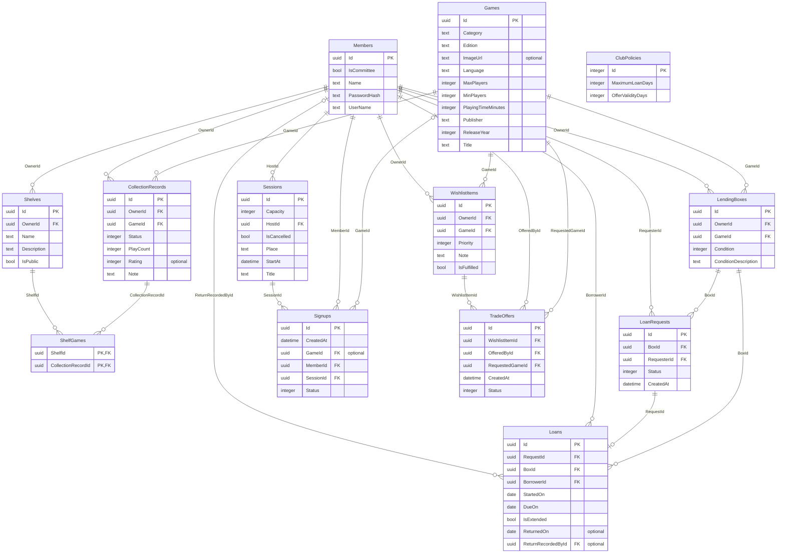

# GameShelf ERD

PK = primaire sleutel; FK = vreemde sleutel; optional = het veld mag leeg zijn.
De 13 tabellen en relaties zijn gegenereerd uit `gameshelf-demo.db`. ClubPolicies bevat de clubtermijnen.
